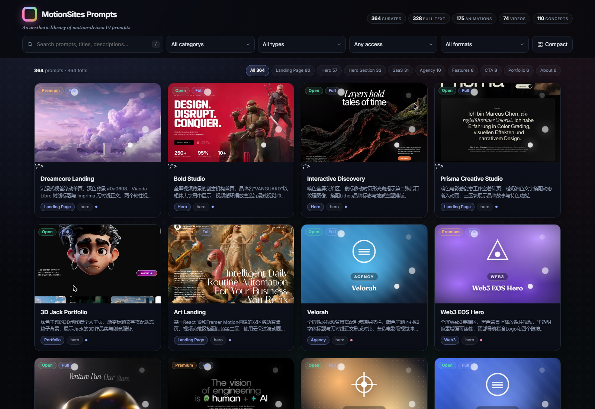
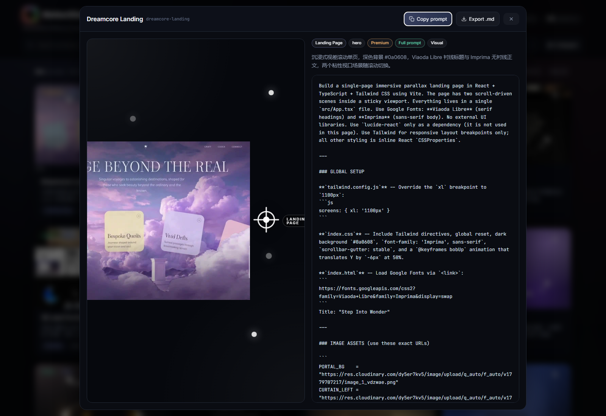

# MotionSites Prompts — A Curated Library of Motion-Driven UI

> A progressively-loaded, **offline-first** catalog of **361 motion-driven UI prompts** — landing pages, hero scenes, agency showcases, dashboards, and now a **44-prompt replication-recipe pack** that turns "make it look like that site" into a measured, reproducible workflow. Browse, search, copy, and export every prompt locally. **No login, no third-party tracking, no paywall, no external CDN at load time.**

## What is inside

- **361 curated prompts** — every card has both a working preview and a full prompt body
- **361 full prompt bodies** — copy to clipboard or export as a Markdown file
- **44 replication recipes** (new in 1.2.0) — capture a reference, extract its real motion values, rebuild it, and prove the result. Three tracks: reverse-engineering (`morluto/rea`), craft pipeline (`storytold/craft-anything`), and community effect patterns (MIT-licensed libraries). See [docs/recipe-pack.md](docs/recipe-pack.md)
- **193 image previews** (static webp / png)
- **168 looping video previews** (mp4, generated locally from CSS demos for the recipe pack)
- **0 concept cards** — every published card has a real preview
- **Multi-dimensional filters**: category, type, source (MotionSites / Community / Recipe pack), media format
- **Top-9 category chips** with live counts from the lite payload — the recipe pack has its own chip
- **Combined search** over title / description / prompt text / tags / source repo / file path
- **Keyboard-first**: `/` focus search, `Esc` close modal, `G` toggle compact
- **Spotlight search**: when a query is active, a soft glow tracks the best matching card
- **Two card densities**: standard 16:10 grid and compact
- **Sticky hero** with brand mark, tagline, and live counters (cards, full text, animations, videos, recipes)





---

## Live deployments

| URL | Hosting | Status |
|---|---|---|
| **https://motionsites-prompts.pages.dev/** | Cloudflare Pages (Direct Upload via wrangler) | Primary |
| **https://zhaosenlin12-creator.github.io/MotionSites/** | GitHub Pages (auto-deploy from `main`) | Backup |

**Both deployments serve the same static build** — same `index.html`, `ms_script.js`, `data/`, `assets/`. The only differences are the host header and cache TTL rules shipped via `_headers` (CF Pages) vs. GitHub Pages defaults.

### Why two deployments?

- **Cloudflare Pages** has its own edge CDN, respects `_headers` and `_redirects`, and serves a fresh build within ~30 seconds of `wrangler pages deploy`.
- **GitHub Pages** uses the Fastly CDN with default `max-age=600` cache. No `_headers` / `_redirects` support. Used as a redundant mirror so the project never depends on a single provider.

Cold-cache FCP on a typical broadband connection: **~140 ms** to first paint of the hero bar, **~280 ms** to first card preview rendered.

---

## Architecture (all local, zero external CDN)

The **initial payload is about 0.6 MB** — HTML, the client script, ~30 KB gzipped catalog data, and the two preloaded fonts. All 361 previews (webp / mp4) are lazy-loaded by an IntersectionObserver with a capped video queue. **Zero `fetch()` calls go to any external domain at page load.**

### Request waterfall on cold cache

```
index.html                                ~32 KB   HTML + inline skeleton
  assets/fonts/fonts.css                   ~2 KB    11 @font-face rules
  assets/fonts/inter-400-n.woff2          ~48 KB   preloaded
  assets/fonts/fraunces-400-n.woff2       ~36 KB   preloaded
  ms_script.js?v=20261122v1               ~46 KB   defer
  data/catalog-lite.json?v=...            ~2 KB    header counters + chips
  data/catalog-meta.json?v=...            ~29 KB   361 cards (gzip)
  data/catalog-text-index.json?v=...      ~22 KB   lazy on modal open
  assets/previews/<id>.{webp|mp4}         lazy via IntersectionObserver
```

All assets live in `assets/` and `data/`. No `<link rel="preconnect">` to third-party origins.

### Self-hosted fonts

Three fonts in use (Inter / Fraunces / JetBrains Mono). All 11 latin woff2 subsets served locally (`assets/fonts/`). No Google Fonts, no gstatic, no fonts.googleapis.com — `scripts/tests/recipe-pack.test.js` fails the build if an external font origin ever comes back.

### Cache bust strategy

`scripts/build.js` writes one `BUILD_STAMP` (`20261122v1`) into the `ms_script.js` tag and the client appends the same stamp to every `data/*.json` fetch, so a fresh deploy forces a cache miss on returning browsers without a manual hard-reload. A unit test asserts both stamps stay in sync.

---

## The recipe pack (v1.2.0)

44 prompts that answer *"how do I reproduce this premium website effect?"* rather than *"what should the page contain?"*. Each one is a self-contained English prompt (140–320 words) with acceptance criteria, plus a locally rendered motion preview:

| Track | Prompts | What it teaches |
|---|---|---|
| Reverse-engineering (`morluto/rea`, MIT) | 14 | Deterministic capture scenarios, `getAnimations()` / CDP value harvesting, GSAP timeline recovery, CSSOM keyframe mining, scroll choreography maps, pointer mechanics, WebGL/Lottie recovery, performance budgets |
| Craft pipeline (`storytold/craft-anything`, Apache-2.0) | 14 | Screenshot → blueprint, design tokens, interaction state machines, motion tokens, material systems, hero rebuild, scroll storytelling, gesture specs, 3D scenes, micro-interactions, responsive/a11y parity, acceptance harness, masked pixel diff, 30-minute clone playbook |
| Community effects (MIT sources) | 16 | Liquid chrome hero, grain mesh, kinetic type, decrypt text, magnetic buttons, tilt cards, marquee, sticky stack, horizontal gallery, scroll-driven reveal, WebGL distortion, image trail, curtain transition, view transitions, Lenis choreography, glass bento |

The previews are **not screenshots of other people's sites**. They are original CSS compositions rendered to mp4 + webp by `scripts/render_recipe_previews.py` from `scripts/recipe_demo.html`, then frozen frame-by-frame through `window.__seek(ms)` so every loop is deterministic. Rendering needs Python + Playwright + ffmpeg; the site itself needs none of them.

Adding or editing a recipe: edit `data/recipe_pack.json` → render previews → `node scripts/build.js` → `node scripts/build_recipe_docs.js`. Full flow in [docs/recipe-pack.md](docs/recipe-pack.md).

---

## File layout

```
MotionSites/
|-- index.html                       Single-page entry (~32 KB)
|-- ms_script.js                    All JS: catalog, render, filters, modal (~46 KB)
|-- ms_template.html                Page shell + CSS that build.js renders into index.html
|-- wrangler.toml                   Cloudflare Pages project config
|-- _headers                        CF-only: per-path Cache-Control rules
|-- _redirects                      CF-only: 301 rules for renamed assets
|
|-- data/                           Progressive JSON catalog
|   |-- catalog-lite.json           ~2 KB   counters, top categories
|   |-- catalog-meta.json           ~163 KB all 361 card entries (gzip ~29 KB)
|   |-- catalog-details.json        ~194 KB per-card metadata (lazy)
|   |-- catalog-text-index.json     ~22 KB id -> .txt path map
|   |-- catalog-text.json           ~3 MB inline prompt bodies (legacy single-file form)
|   |-- catalog-text/<id>.txt       361 files, one per card with text
|   |-- recipe_pack.json            Source of truth for the 44 replication recipes
|   |-- catalog_sources.json        External feeds + licences used for the catalog
|   |-- ms_prompts_merged.json      Build source: metadata records (catalog + imports)
|   |-- ms_prompts_with_text.json   Build source: prompt bodies
|
|-- assets/
|   |-- previews/<id>.{webp,mp4,png}     259 webp + 150 mp4 + 1 png (~99 MB total)
|   |-- community/superdesign/<dir>/     community-source mp4 previews
|   |-- fonts/{inter,fraunces,jetbrains-mono}-*.woff2  11 latin subsets
|
|-- scripts/                        Build / scrape / normalize / audit
|   |-- build.js                    Deterministic catalog build + index.html render
|   |-- audit-catalog.js            Count + provenance + orphan-asset audit
|   |-- build_recipe_docs.js        Generate docs/recipe-pack.md from the pack
|   |-- render_recipe_previews.py   Render recipe mp4/webp previews (Playwright + ffmpeg)
|   |-- recipe_demo.html / .js      Pure-CSS demo kit behind every recipe preview
|   |-- import-community.js         Pull new prompts from community repos
|   |-- normalize-categories.js     Collapse synonyms to canonical labels
|   |-- dedupe-catalog.js           Drop duplicate IDs after import
|   |-- download-gigl-previews.js   Fetch missing previews from giglianepefrei
|   |-- lib/catalog-utils.js        Sorting, hashing, audit helpers
|   |-- tests/*.test.js             Node test suites (build, pack, import, media)
|
|-- deploy/
|   |-- deploy-wrangler.ps1         Cloudflare Pages direct upload
|   |-- deploy-cloudflare.ps1       Legacy Cloudflare API deploy (older)
|   |-- push-to-github.ps1          Push to origin/main with retry
|
|-- docs/                           Screenshots, perf logs, recipe-pack index
|-- CHANGELOG.md                    Per-release change log (1.0.0 -> 1.2.0)
|-- CONTRIBUTING.md                 File format + build flow
|-- README.md                       This file
|-- LICENSE                         MIT
```

---

## Run it locally

Any static server works (no Node required to use the catalog):

```bash
git clone https://github.com/zhaosenlin12-creator/MotionSites.git
cd MotionSites
python -m http.server 8000
# or
npx serve .
# then visit http://localhost:8000
```

Rebuild the catalog after editing `data/` (Node 18+):

```bash
node scripts/build.js          # catalog-*.json + index.html
node scripts/audit-catalog.js  # counts, bodies, orphans
node --test scripts/tests/*.test.js
```

Note: opening `index.html` directly via `file://` works for the static HTML, but `fetch()` is blocked by browsers on `file://` URLs, so the catalog data will not load. Use a local server.

---

## Deploy

### Cloudflare Pages (primary)

The `wrangler.toml` points at the `motionsites-prompts` project on Cloudflare Pages with the repo root as the build output. Deployment is a single command:

```powershell
.\deploy\deploy-wrangler.ps1 -CommitHash <sha> -CommitMessage "msg"
```

The script stages the repo into a temp dir (excluding `.git`, `.wrangler`, `node_modules`, files >25 MiB) and runs `wrangler pages deploy`. After about 30 s the new version is live at `https://motionsites-prompts.pages.dev/`.

`_headers` ships with `/assets/* Cache-Control: public, max-age=31536000, immutable` so woff2 / webp / mp4 are long-lived. `_redirects` handles the one renamed asset (`website-builder.mp4` -> `.webp`) on CF Pages (GH Pages does not honor `_redirects`, so the in-repo mp4 stub handles it there instead).

### GitHub Pages (backup)

`main` is auto-deployed by the GitHub Pages integration. Each push typically surfaces within 1-3 minutes. Cache is the default `max-age=600` for all paths, which is why the JS / CSS use a `?v=YYYYMMDDvx` build stamp — when a fresh stamp ships, returning browsers pick it up on next visit.

GH Pages does not honor `_headers` / `_redirects`. We:
- Ship the renamed-asset stub (`assets/previews/website-builder.mp4` is a 2.1 KB 1-second h264 black frame) so any stale `.mp4` URL still returns a real video payload instead of bogus webp_pipe bytes.
- Put `?v=N` cache-bust stamps on `ms_script.js`, `fonts.css`, and the two preloaded woff2 URLs so users with cached assets see the new versions on next load.

### Push to GitHub

```powershell
git push origin main
```

The first push after a long offline stretch may take a few minutes if the commit touches a large number of binaries. If `git push` times out, retry with `git push origin main --no-thin`.

---

## Counts (live)

```
Total         361
With text     361   (every card has a full body)
Images        193   (webp / png / jpg previews)
Videos        168   (mp4 loops; includes the 44 recipe previews)
Concepts        0   (every card has a real preview)
Recipes        44   (source_kind=recipes, the replication pack)
Motionsites   296   (source_kind=motionsites)
Community      21   (source_kind=community)
Categories     60   (canonical labels)
```

The math always sums: `193 + 168 + 0 = 361`, `296 + 21 + 44 = 361`, and `node scripts/audit-catalog.js` re-checks both.

---

## Recent changes

| Version | Date | Highlights |
|---|---|---|
| 1.2.0 | 2026-11-22 | **Recipe pack**: 44 replication prompts (rea / craft-anything / community) with locally rendered mp4+webp previews, a new category chip, source filter and header stat. Rebuilt the pipeline: source files reconciled to the published 317 (the 2026-09 cleanup only pruned generated data), `build.js` is now deterministic and prunes stale text files, template re-synced to the shipped self-hosted-font page, orphan audit fixed, new recipe-pack tests. |
| 1.1.8 | 2026-09-01 | Fix `fonts.css` nested-path bug (all 11 woff2 404); convert 153 `webp_anim` cards to static webp (browser `` first-frame black-screen issue); rename `jetbrains mono` files (no-space URL). |
| 1.1.7 | 2026-08-31 | Self-host Google Fonts (11 latin woff2, 427 KB total); drop the last external CDN dependency at load time. |
| 1.1.6 | 2026-08-31 | Wire 8 missing previews (3 webp/png images + 5 community mp4s); catalog counts 193/124/0 (cleaned). |
| 1.1.5 | 2026-08-31 | Wire `poster_rel` into `<video poster>` (mp4 cards now show webp thumbnail on hover); bump `?v=` cache-bust. |
| 1.1.4 | 2026-08-31 | Fix `website-builder.mp4` misclassification (was webp); restore 11 stale `has_text` flags; re-add `community-superdesign-the-stacking-cards-effect`. |
| 1.1.3 | 2026-08-31 | Prune 11 dead-end cards (no preview, no text). |
| 1.1.2 | 2026-08-31 | Sync 75 new prompts from motionsites.ai. |
| 1.1.1 | 2026-08-31 | Replace hardcoded header counters with live catalog-lite values. |
| 1.1.0 | 2026-08-31 | Cache-bust + i18n (zh-CN / en) switch + per-language labels. |
| 1.0.0 | 2026-08-08 | First stable release: 504 curated prompts across MotionSites + community sources. |

See [CHANGELOG.md](CHANGELOG.md) for the full per-commit log.

---

## Data provenance

| Field | Source |
|---|---|
| Title, description, category, type | `motionsites.ai` public catalog (HTTP scrape, never the paywall) |
| Full prompt body | `motionsites.ai` recovery + community GitHub repos: `xianxian-sensen`, `Melectrona`, `akkikumar72/liro-prompts`, `giglianepefrei`, `superdesigndev/superdesign-prompts` |
| Preview media | Downloaded once from `motionsites.ai` CDN (R2 / CloudFront / higgs.ai / Dribbble) and bundled locally. No runtime fetch to any third party. |
| Recipe prompts | Original syntheses of methods documented by `morluto/rea` (MIT) and `storytold/craft-anything` (Apache-2.0), plus open effect patterns from MIT-licensed libraries (Three.js, Motion, Magic UI, Lenis, vanilla-tilt, Swup) and W3C/MDN web standards. Licences are recorded per recipe in `data/recipe_pack.json` and [docs/recipe-pack.md](docs/recipe-pack.md). |
| Recipe previews | Rendered in-repo from original CSS compositions (`scripts/recipe_demo.*`); no upstream site assets are copied. |

The original `motionsites.ai` paywall is **not** bypassed. Records without a recoverable body or preview are dropped by the build (that invariant is asserted on every run), so the catalog never shows a dead-end card.

---

## Contributing

See [CONTRIBUTING.md](CONTRIBUTING.md) for the file format, build flow, and the ten-minute path to your first PR.

---

## License

[MIT](LICENSE) — free to use, modify, and redistribute. Each individual prompt body retains its original author's copyright; this repository only archives and indexes them.
